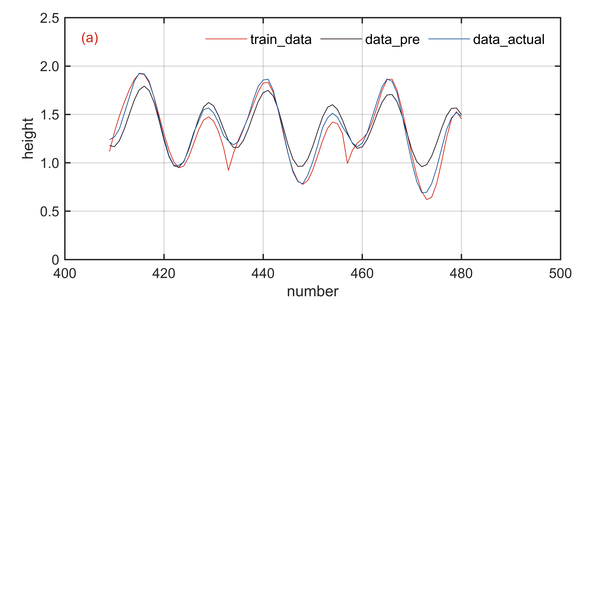

# MATLAB | Time Series Prediction | LSTM Long Short-Term Memory Neural Network | Includes data and plotting code | Directly Hands On

LSTM (Long Short-Term Memory) is a common type of recurrent neural network (RNN) structure. Due to its ability to process long sequences of data, it has been widely used in fields such as speech recognition, natural language processing, and image processing. The main characteristic of the LSTM network is the addition of a "memory cell" structure that controls the flow of information within the network. This structure can remember information and incorporate it into the current processing when needed, thereby better handling long sequence data. Additionally, the LSTM network introduces three structures called "gates," including an input gate (Input Gate), a forget gate (Forget Gate), and an output gate (Output Gate), which control the input, forgetting, and output of information. These gates work by mapping the input information to values between 0 and 1 through a sigmoid function, then performing operations with the information stored in the memory cell to control the flow of information. Through this mechanism, the LSTM network can effectively capture long-term dependencies in sequences, enhancing its capability to process sequence data.
The attached images show the following effects:
\n        \n  
Video tutorial operation:
\n        \n          \n          \n          \n          \n            To view this video please enable JavaScript, and consider upgrading to a\n            web browser that\n            supports HTML5 video\n  

## Images

<!-- PAYMENT_BLOCK -->

## Get this dataset

- Payment link (Stripe): [Buy now](https://buy.stripe.com/3cs8yP7sY87d0vu9AB)
- Payment QR code: 

<!-- /PAYMENT_BLOCK -->
